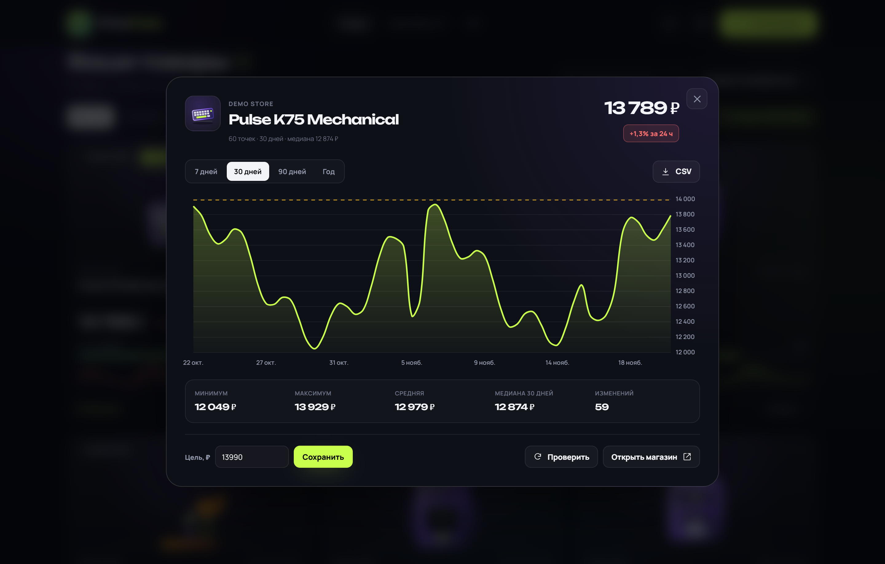
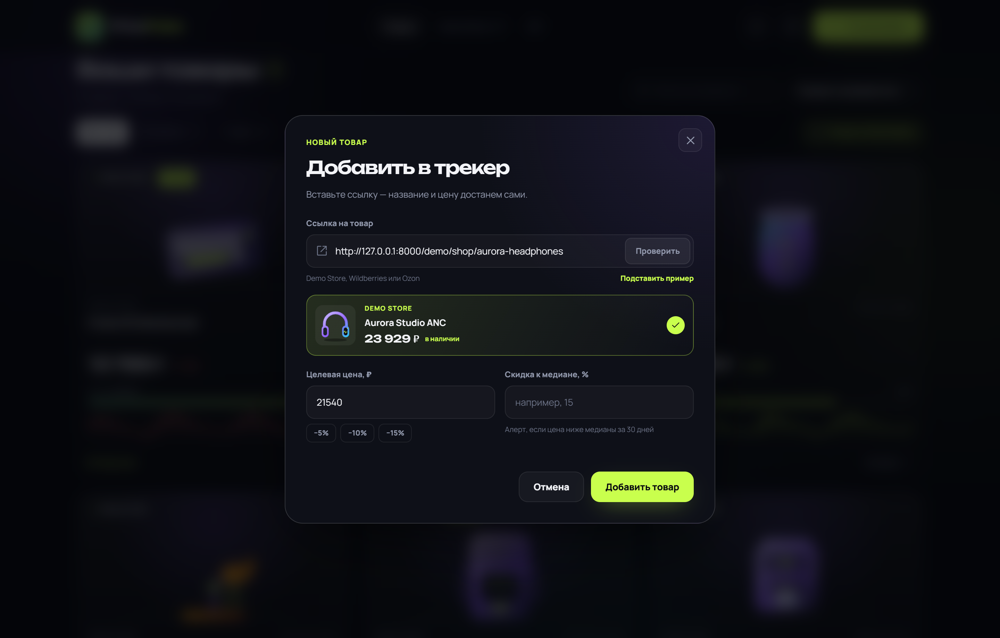
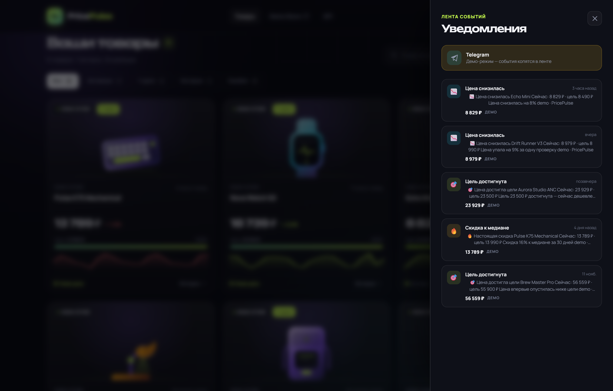
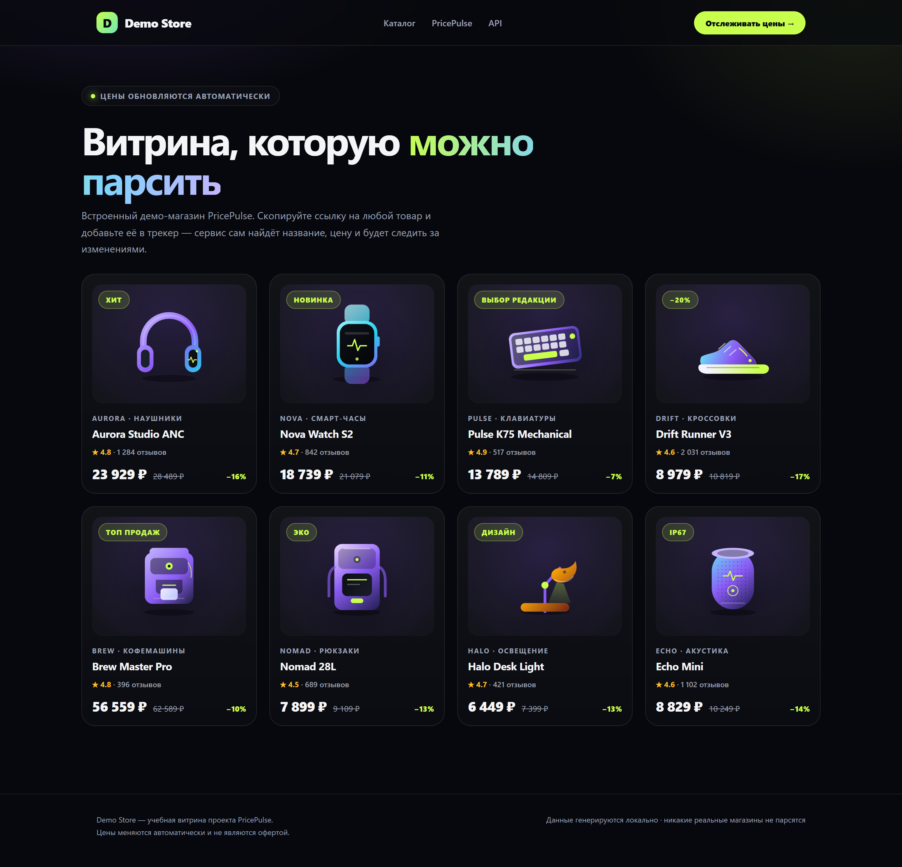
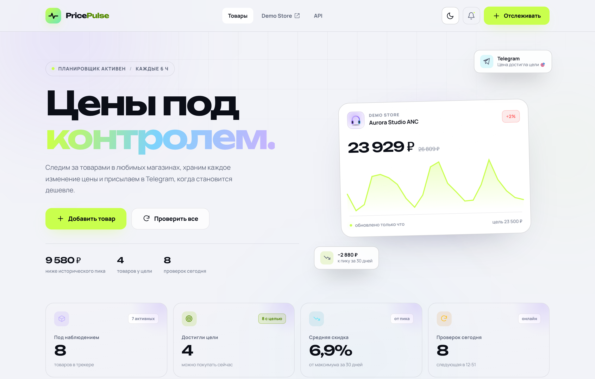
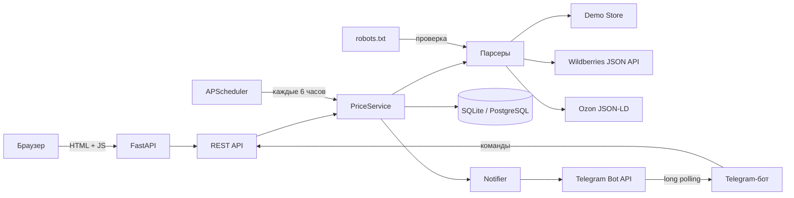
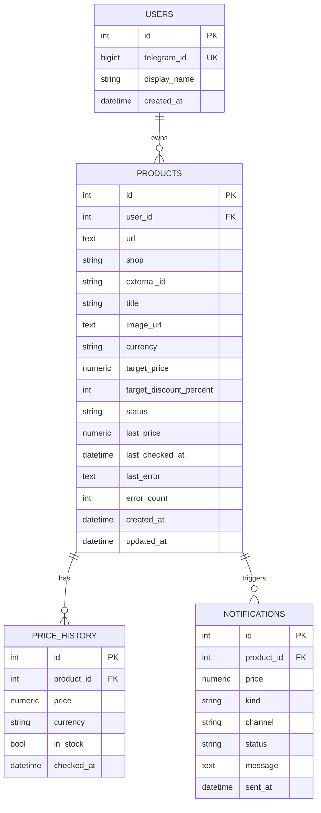

# PricePulse

**Трекер цен с парсерами магазинов, историей, графиками и Telegram-алертами.**

Учебный backend-проект для портфолио: парсинг сайтов, планировщик, проектирование БД с историей изменений, REST API, аккуратный веб-интерфейс и интеграция с внешним API.

[](https://github.com/HBBoy102011/price-pulse/actions/workflows/ci.yml)
[](https://github.com/HBBoy102011/price-pulse/actions/workflows/docker.yml)
[](https://github.com/HBBoy102011/price-pulse/pkgs/container/price-pulse)


<p align="center">
  
</p>

<p align="center">
  <a href="https://newsletters-baths-poly-reggae.trycloudflare.com"><b>Живое демо</b></a>
  ·
  <a href="https://github.com/HBBoy102011/price-pulse/releases/tag/v1.0.0">Release v1.0.0</a>
  ·
  <a href="https://hbboy102011.github.io/price-pulse/">Landing page</a>
  ·
  <a href="https://github.com/HBBoy102011/price-pulse/pkgs/container/price-pulse">Docker image</a>
  ·
  <a href="CONTRIBUTING.md">Contributing</a>
</p>

---

## О проекте

PricePulse следит за товарами в интернет-магазинах: вы вставляете ссылку, сервис сам достаёт название, цену и картинку, сохраняет каждое изменение и присылает сообщение в Telegram, когда цена опускается ниже цели.

Внутри — не «скелет на один эндпоинт», а законченный сервис:

- три парсера с общим интерфейсом и graceful degradation;
- APScheduler с периодическими проверками и защитой от параллельных запусков;
- история цен и статистика (минимум, максимум, средняя, медиана за 30 дней, изменение за сутки);
- алерты по порогу цены, скидке к медиане и резкому падению;
- Telegram-бот с командами, привязкой chat_id через `/start` и ограничением доступа;
- SQLite локально и PostgreSQL в Docker без изменения кода;
- Alembic-миграции, 45 тестов, ruff + black, GitHub Actions и PostgreSQL в CI;
- собственный дашборд без сборщика: тёмная/светлая тема, графики Chart.js, поиск, фильтры, модальные окна и CSV-экспорт.

### Почему это интересно смотреть

| Что показано | Где смотреть |
|---|---|
| Парсинг HTML и JSON API | `app/parsers/` |
| Устойчивость к ошибкам и антиботу | `app/services/price_service.py` |
| Планировщик и фоновые задачи | `app/scheduler.py` |
| БД с историей и каскадами | `app/models/models.py` |
| REST API и валидация | `app/api/`, `app/schemas.py` |
| Telegram-бот и long polling | `app/bot/` |
| Визуализация и UX | `web/` |
| Тесты, миграции, Docker, CI | `tests/`, `migrations/`, `Dockerfile`, `.github/` |

---

## Возможности

### Товары и цены

- Добавление товара по ссылке с предпросмотром **до** сохранения.
- Автоматическое определение магазина, названия, цены, валюты и изображения.
- История цен: каждое изменение — отдельная запись.
- Статистика: минимум, максимум, средняя, медиана 30 дней, изменение за 24 часа, число изменений, экономия от исторического пика.
- Пауза и возобновление отслеживания, редактирование порога, удаление вместе с историей.
- Ручная проверка одного товара или всех сразу.
- Экспорт истории в CSV (`;`, UTF-8 BOM — открывается в Excel).

### Уведомления

- 🎯 **Цель достигнута** — цена опустилась до заданного порога.
- 🔥 **Настоящая скидка** — цена ниже медианы за 30 дней на заданный процент.
- 📉 **Резкое падение** — цена упала более чем на 8% за одну проверку.
- ⚠️ **Ошибка парсера** — товар не проверяется после 3 неудач подряд.
- Все события сохраняются в ленту. Если Telegram не настроен, они получают статус `skipped` — демо-режим виден прямо в интерфейсе.
- Кулдауны: цель и падение — раз в 24 часа, скидка — раз в 7 дней, ошибка — раз в 24 часа.

### Telegram-бот

Бот — не только отправщик алертов. Им можно пользоваться как полноценным клиентом:

| Команда | Что делает |
|---|---|
| `/start` | Приветствие, привязка Telegram-аккаунта и chat_id |
| `/help` | Список команд |
| `/list` | Товары пользователя с ценами, целями и статусом |
| `/add <ссылка> [цель] [скидка %]` | Добавить товар; ссылку можно отправить и без команды |
| `/check [id\|all]` | Проверить один товар или все |
| `/stats <id>` | Минимум, максимум, средняя, медиана, скидка и изменение за 24 часа |
| `/target <id> <цена\|off>` | Изменить или снять цель |
| `/pause <id>` / `/resume <id>` | Пауза и возобновление |
| `/export <id>` | CSV с историей прямо в чат |
| `/delete <id>` | Удаление с подтверждением |
| `/cancel` | Отменить текущий диалог добавления |
| `/id` | Показать Telegram ID и chat ID |

Что важно:

- `/start` создаёт локального пользователя и запоминает `telegram_id` — отдельно вводить chat_id не нужно.
- Каждый пользователь видит только свои товары; уведомления уходят в его чат.
- Доступ можно закрыть списком `TELEGRAM_ALLOWED_USER_IDS`.
- Long polling работает и отдельным процессом (`python -m app.bot`), и фоновой задачей приложения (`TELEGRAM_BOT_POLLING=true`).
- Все команды покрыты тестами через фейковый Telegram API, поэтому для проверки логики токен не нужен.

### Дашборд

- Тёмная glassmorphism-тема и светлая тема с сохранением выбора.
- Живые метрики: товары, цели, средняя скидка, проверки за день.
- Карточки со sparkline, прогрессом до цели и статусом.
- График цены за 7 / 30 / 90 дней или год, линия цели, тултипы, статистика за выбранный период.
- Поиск, фильтры по статусу, сортировка, скелетоны загрузки и пустые состояния.
- Лента уведомлений, тосты, горячие клавиши (`/` — поиск, `Esc` — закрыть).
- Полностью адаптивная вёрстка, шрифты Manrope и Unbounded хостятся локально.

### Встроенный Demo Store

Чтобы проект можно было запустить и показать без внешней сети, внутри приложения живёт демо-магазин:

- 8 товаров с SVG-иллюстрациями и карточками товара;
- детерминированные «плавающие» цены — история всегда выглядит живой;
- страницы размечены атрибутами `data-product-*`, которые читает парсер;
- собственный `robots.txt`.

---

## Скриншоты

### График цены

<p align="center">
  
</p>

### Добавление товара с предпросмотром

<p align="center">
  
</p>

### Лента уведомлений

<p align="center">
  
</p>

### Demo Store

<p align="center">
  
</p>

### Светлая тема

<p align="center">
  
</p>

<details>
<summary>Swagger UI</summary>

<p align="center">
  
</p>

</details>

---

## Технологии

| Слой | Технология | Зачем |
|---|---|---|
| Язык | Python 3.11+ | Современный синтаксис, `asyncio` |
| API | FastAPI + Pydantic 2 | Валидация, OpenAPI, async |
| ORM | SQLAlchemy 2 + Alembic | Модели, миграции |
| БД | SQLite → PostgreSQL | Старт без зависимостей, прод — Postgres |
| Парсинг | httpx + BeautifulSoup4 | HTML и JSON API |
| Планировщик | APScheduler | Периодические проверки |
| Графики | Chart.js 4 | Без сборщика и CDN |
| Уведомления | Telegram Bot API | Алерты и команды |
| Бот | httpx + long polling | Без тяжёлого фреймворка |
| Тесты | pytest + pytest-cov | 45 тестов, SQLite и PostgreSQL |
| Качество | ruff + black + alembic check | Линт, формат, миграции |
| Деплой | Docker, GHCR, Render | Локально, VPS и PaaS |

---

## Архитектура



**Как проходит проверка:**

1. Планировщик запускает `check_all()` и берёт активные товары.
2. Для каждого товара проверяется `robots.txt` и минимальный интервал между запросами.
3. Парсер магазина возвращает нормализованный `ParsedProduct`.
4. Если цена изменилась — в `price_history` добавляется запись.
5. `PriceService` проверяет цель, скидку к медиане и падение, создаёт уведомления.
6. Уведомление сохраняется в БД и отправляется в Telegram (или остаётся в демо-режиме).
7. Ошибка увеличивает `error_count`; после порога товар получает статус `error`, а при успехе счётчик сбрасывается.

---

## Модель данных



Ключевые решения:

- `UNIQUE(user_id, url)` защищает от дублей на уровне БД.
- История и уведомления удаляются каскадом вместе с товаром.
- Индексы `(product_id, checked_at)` и `(product_id, sent_at)` ускоряют графики и ленту.
- Деньги хранятся в `Numeric(12, 2)`, а не в `float`.

---

## Быстрый старт

### 1. Клонирование и зависимости

```bash
git clone https://github.com/HBBoy102011/price-pulse.git
cd price-pulse

python -m venv .venv

# Windows
.venv\Scripts\activate
# macOS / Linux
source .venv/bin/activate

pip install -r requirements-dev.txt
```

### 2. Конфигурация

```bash
cp .env.example .env
```

Для локального запуска менять ничего не нужно: используется SQLite и демо-режим Telegram.

### 3. Демо-данные (опционально, но красиво)

```bash
python -m scripts.seed_demo
```

Скрипт создаёт 8 товаров и 90 дней истории — дашборд сразу выглядит живым.

### 4. Запуск

```bash
uvicorn app.main:app --reload
```

| Адрес | Что там |
|---|---|
| http://localhost:8000 | Дашборд |
| http://localhost:8000/docs | Swagger UI |
| http://localhost:8000/demo/shop | Demo Store |
| http://localhost:8000/api/health | Health check |

> Миграции: локально таблицы создаются автоматически (`AUTO_CREATE_TABLES=true`). Для продакшена выполните `alembic upgrade head` и выставьте `AUTO_CREATE_TABLES=false`.

---

## Docker

В репозитории есть `Dockerfile` и `docker-compose.yml` с PostgreSQL.

```bash
docker compose up --build
```

- приложение: http://localhost:8000
- PostgreSQL: внутренний сервис `db`, данные в volume `pgdata`
- миграции применяются автоматически перед стартом (`alembic upgrade head`)

Заполнить демо-данными:

```bash
docker compose exec app python -m scripts.seed_demo
```

Остановить и удалить данные:

```bash
docker compose down -v
```

### Готовый образ из GHCR

Каждый push в `main` и каждый тег `v*` собирает multi-arch образ
(`linux/amd64`, `linux/arm64`):

```bash
docker pull ghcr.io/hbboy102011/price-pulse:latest
docker run --rm -p 8000:8000 \
  -e DATABASE_URL=sqlite:////data/pricepulse.db \
  -v pricepulse-data:/data \
  ghcr.io/hbboy102011/price-pulse:latest
```

Для PostgreSQL передайте `DATABASE_URL` и `AUTO_CREATE_TABLES=false`.

---

## Демо и деплой

- **Живое демо (временное):** <https://newsletters-baths-poly-reggae.trycloudflare.com>
  — Cloudflare quick tunnel к локальному Docker-стеку. Ссылка работает, пока
  запущен туннель; для постоянной ссылки используйте Render Blueprint ниже.
- **Landing page:** <https://hbboy102011.github.io/price-pulse/>
- **One-click Render Blueprint:** [render.yaml](render.yaml) + PostgreSQL 16.
  Кнопка ниже создаёт web-сервис и базу, останется указать токен бота:

  [](https://render.com/deploy?repo=https://github.com/HBBoy102011/price-pulse)

- **GHCR:** `docker pull ghcr.io/hbboy102011/price-pulse:latest`
- **Release:** <https://github.com/HBBoy102011/price-pulse/releases/tag/v1.0.0>

После деплоя на Render:

1. Откройте сервис и добавьте `TELEGRAM_BOT_TOKEN`.
2. Укажите свой ID в `TELEGRAM_ALLOWED_USER_IDS` (бот покажет его по `/id`).
3. `TELEGRAM_BOT_POLLING=true` уже включён в blueprint.
4. Демо-данные: `python -m scripts.seed_demo` через Render Shell.

---

## Telegram

1. Создайте бота у [@BotFather](https://t.me/BotFather): `/newbot` → получите токен.
2. Заполните `.env`:

```env
TELEGRAM_BOT_TOKEN=123456:AA...
TELEGRAM_BOT_POLLING=true
TELEGRAM_ENABLED=true

# Необязательно: фиксированный чат для алертов и whitelist бота.
TELEGRAM_CHAT_ID=
TELEGRAM_ALLOWED_USER_IDS=
```

3. Перезапустите приложение и отправьте боту `/start`.
   Он создаст локального пользователя, запомнит `telegram_id` и покажет команды.
4. Добавьте товар: `/add https://www.wildberries.ru/catalog/... 15000 10`.
5. Проверьте: `/check all`; статистика: `/stats 1`; CSV: `/export 1`.

`chat_id` вручную вводить не нужно: `/start` привязывает его автоматически.
Если `TELEGRAM_ALLOWED_USER_IDS` пуст, бот открыт всем — для публичного демо
лучше указать свой ID (его показывает `/id`).

### Отдельный процесс бота

Если не хотите держать polling внутри веб-процесса:

```bash
python -m app.bot
```

В Docker включите `TELEGRAM_BOT_POLLING=true` и перезапустите контейнер.
Polling должен работать ровно на одном инстансе, иначе Telegram разделит
обновления между ними.

Без токена сервис работает в **демо-режиме**: уведомления создаются, сохраняются
в ленте и помечаются как `skipped`. Это позволяет показывать весь сценарий без
внешних секретов.

---

## REST API

Полная интерактивная документация — `/docs`.

| Метод | Эндпоинт | Описание |
|---|---|---|
| `GET` | `/api/health` | Статус приложения, БД и планировщика |
| `GET` | `/api/summary` | Сводка для дашборда |
| `GET` | `/api/shops` | Поддерживаемые магазины |
| `GET` | `/api/products` | Список товаров (`status`, `shop`, `q`, `sort`) |
| `POST` | `/api/products` | Добавить товар по ссылке |
| `POST` | `/api/preview` | Разобрать ссылку без сохранения |
| `GET` | `/api/products/{id}` | Карточка товара |
| `PATCH` | `/api/products/{id}` | Изменить цель, скидку, статус, название |
| `DELETE` | `/api/products/{id}` | Удалить товар и историю |
| `POST` | `/api/products/{id}/check` | Проверить один товар (`?force=true`) |
| `GET` | `/api/products/{id}/history` | История (`days`, `limit`) |
| `GET` | `/api/products/{id}/stats` | Статистика |
| `GET` | `/api/products/{id}/history.csv` | CSV-экспорт |
| `GET` | `/api/products/{id}/notifications` | Уведомления товара |
| `POST` | `/api/check` | Проверить все активные товары |
| `GET` | `/api/notifications` | Лента событий (`limit`, `kind`, `status`) |

### Примеры

Добавить товар:

```bash
curl -X POST http://localhost:8000/api/products \
  -H "Content-Type: application/json" \
  -d '{
    "url": "http://localhost:8000/demo/shop/aurora-headphones",
    "target_price": 22000,
    "target_discount_percent": 10
  }'
```

Предпросмотр без сохранения:

```bash
curl -X POST http://localhost:8000/api/preview \
  -H "Content-Type: application/json" \
  -d '{"url": "http://localhost:8000/demo/shop/nova-watch"}'
```

Запустить проверку вручную:

```bash
curl -X POST http://localhost:8000/api/check \
  -H "Content-Type: application/json" \
  -d '{"force": true}'
```

Скачать историю:

```bash
curl -OJ http://localhost:8000/api/products/1/history.csv
```

---

## Парсеры и этика

| Магазин | Способ | Статус |
|---|---|---|
| **Demo Store** | HTML, атрибуты `data-product-*` | Работает офлайн, используется в тестах |
| **Wildberries** | Публичный JSON API карточки товара | Основной «реальный» парсер |
| **Ozon** | JSON-LD + резервный разбор HTML | Best effort: Ozon может включить антибот |

Общий интерфейс:

```python
class BaseParser(ABC):
    def can_handle(self, url: str) -> bool: ...
    async def parse(self, url: str) -> ParsedProduct: ...
```

Добавить новый магазин = создать класс-наследник и зарегистрировать его в `app/parsers/registry.py`.

### Принципы

- **robots.txt** проверяется перед запросом и кешируется на 6 часов.
- **Честный User-Agent**: `PricePulseBot/1.0 (+ссылка на репозиторий)`.
- **Пауза между запросами** (`REQUEST_DELAY_SECONDS=0.4`).
- **Минимальный интервал** между проверками одного товара — 30 минут.
- Нет обхода авторизации, капчи и платных API.
- Проект **учебный**: не используйте его для коммерческого скрейпинга и уважайте условия площадок.

---

## Тесты и качество кода

```bash
pytest -q
ruff check .
black --check .
```

Покрыто:

- нормализация цен (`12 990,50 ₽`, `$1,299.00`, `1.299,00 €`);
- парсинг Demo Store, Wildberries JSON и Ozon JSON-LD на сохранённых фикстурах;
- CRUD, предпросмотр, история, CSV, ручная проверка;
- уведомления о цели, скидке, падении и ошибке;
- порог из 3 ошибок и сброс счётчика при успехе;
- rate-limit: повторная проверка слишком рано возвращает `skipped`;
- команды Telegram-бота, callback-кнопки и ограничение доступа;
- health-check и сводка дашборда.

С покрытием:

```bash
pytest --cov=app --cov-report=term-missing
```

CI прогоняет линтер, форматтер и тесты на Python 3.11, 3.12 и 3.13,
отдельный job — на PostgreSQL 16, ещё один проверяет `alembic upgrade head`
и `alembic check`.

---

## Структура проекта

```text
price-pulse/
├── app/
│   ├── api/                 # products, checks, dashboard, demo
│   ├── bot/                 # Telegram API, команды, long polling
│   ├── models/              # SQLAlchemy-модели
│   ├── parsers/             # base, demo, wildberries, ozon, registry
│   ├── services/            # price_service, notifier, robots, stats, export
│   ├── config.py            # настройки из .env
│   ├── database.py          # engine, session, init_db
│   ├── demo_catalog.py      # каталог Demo Store
│   ├── demo_shop_pages.py   # HTML витрины
│   ├── main.py              # FastAPI-приложение
│   ├── scheduler.py         # APScheduler
│   └── schemas.py           # Pydantic-схемы
├── migrations/              # Alembic
├── scripts/
│   ├── seed_demo.py         # демо-данные
│   └── capture_screenshots.py
├── tests/                   # pytest + фикстуры
├── web/                     # дашборд: HTML, CSS, JS, шрифты, Chart.js
├── docs/                    # landing page и скриншоты
├── Dockerfile
├── docker-compose.yml
├── render.yaml              # one-click деплой на Render
├── CHANGELOG.md
├── CONTRIBUTING.md
├── SECURITY.md
├── pyproject.toml
└── .github/                 # CI, Docker, шаблоны issue/PR
```

---

## Roadmap

- [x] MVP: добавление по ссылке, 3 парсера, история, график, Telegram
- [x] Скидка к медиане и обнаружение резких падений
- [x] CSV-экспорт, пауза, ручная проверка
- [x] Alembic, Docker, GHCR, CI на SQLite и PostgreSQL, 45 тестов
- [x] Telegram-бот с командами и привязкой chat_id через `/start`
- [x] Релиз v1.0.0, CHANGELOG, шаблоны issue/PR, SECURITY
- [ ] Playwright для сайтов, которые рендерят цену на клиенте
- [ ] Сравнение одного товара в нескольких магазинах
- [ ] JWT-авторизация и мультипользовательность в веб-интерфейсе
- [ ] Email, Web Push и Discord/Slack-вебхуки
- [ ] Celery + Redis для горизонтального масштабирования
- [ ] Постоянный демо-стенд на Render / Fly.io / VPS

---

## Contributing

Хотите добавить магазин, команду бота или улучшить UI?

- [CONTRIBUTING.md](CONTRIBUTING.md) — окружение, стиль, тесты и правила PR.
- [CODE_OF_CONDUCT.md](CODE_OF_CONDUCT.md) — правила общения.
- [SECURITY.md](SECURITY.md) — как сообщить об уязвимости.
- [CHANGELOG.md](CHANGELOG.md) — история версий.
- Шаблоны [issue](https://github.com/HBBoy102011/price-pulse/issues/new/choose)
  и [Pull Request](.github/PULL_REQUEST_TEMPLATE.md) уже настроены.

Перед PR:

```bash
pytest -q
ruff check .
black --check .
alembic check
```

---

## Лицензия

[MIT](LICENSE) © 2026 HBBoy102011

Проект создан в учебных целях. Парсите бережно: `robots.txt`, лимиты и честный User-Agent уже встроены.
